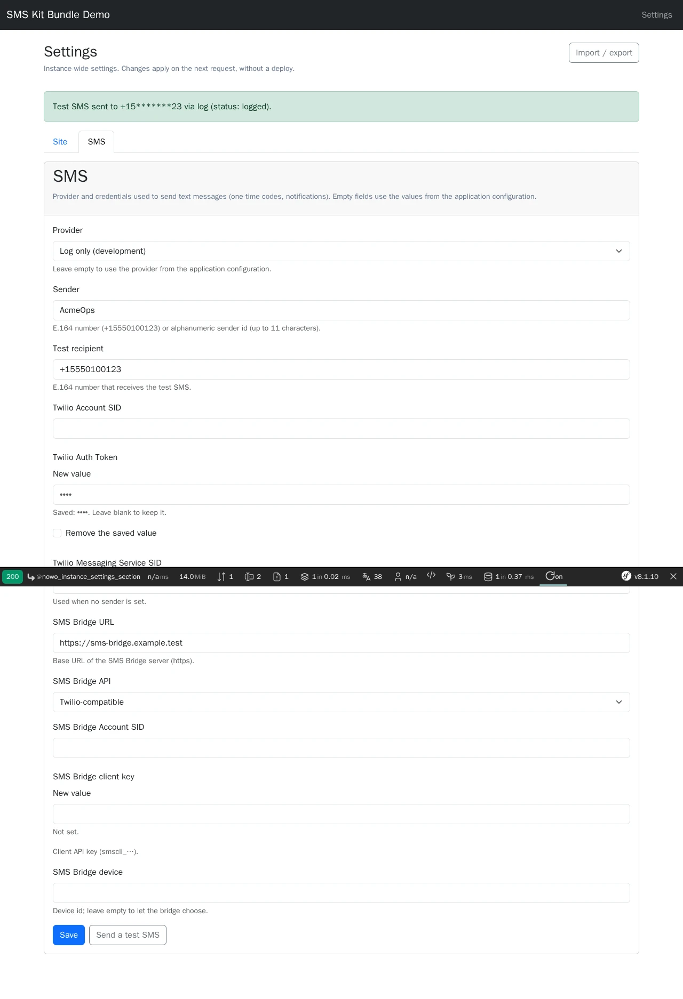

# SMS Kit Bundle

[](https://github.com/nowo-tech/SmsKitBundle/actions/workflows/ci.yml) [](https://packagist.org/packages/nowo-tech/sms-kit-bundle) [](https://packagist.org/packages/nowo-tech/sms-kit-bundle) [](LICENSE) [](https://php.net) [](https://symfony.com) [](https://github.com/nowo-tech/SmsKitBundle) [](#tests-and-coverage)

> ⭐ **Found this useful?** [Install from Packagist](https://packagist.org/packages/nowo-tech/sms-kit-bundle) · Give it a **star** on [GitHub](https://github.com/nowo-tech/SmsKitBundle) so more developers can find it.

**SMS Kit Bundle** — send text messages from a Symfony app through a **provider registry** (Twilio, SMS Bridge, a log provider for development, a null provider, and your own tagged providers), with the provider and its credentials chosen at **runtime** in an `sms` section of [InstanceSettingsBundle](https://github.com/nowo-tech/InstanceSettingsBundle) (tokens encrypted at rest), E.164 validation, guarded and time-limited provider HTTP calls, masked logging, a `nowo:sms:send` test command, a CSRF-protected and rate-limited **"Send a test SMS"** admin action, and an **AuthKit** adapter that sends password-reset codes by SMS. Tested on Symfony **7.4**, **8.0** and **8.1** · PHP 8.2+ (Symfony 8.x requires PHP 8.4+).


This bundle is **FrankenPHP worker mode friendly**.

The provider and its configuration are resolved on every send and memoized for the current main request only; a settings change (`SettingsChangedEvent`) or `kernel.reset` drops the memo, so a new provider or token applies to the very next message in every worker. See [docs/FRANKENPHP-WORKER-AUDIT.md](docs/FRANKENPHP-WORKER-AUDIT.md).

## Screenshots



## Features

- **Provider registry** — `SmsProviderInterface` services are autoconfigured (tag `nowo_sms_kit.provider`) and become the choices of the `sms.provider` setting. Bundled: `twilio`, `sms_bridge` (Twilio-compatible or native API), `log` (writes masked metadata, sends nothing) and `null` (disabled, the default).
- **Runtime configuration** — the `sms` instance settings section stores the provider, the sender (E.164 number or alphanumeric id), a test recipient and the provider credentials; Auth Tokens and client keys are **encrypted secrets** never rendered back. Empty fields fall back to `nowo_sms_kit.*` configuration (typically `%env()%`).
- **One sender API** — `SmsSenderInterface::send(new SmsMessage($to, $body))`, `isConfigured()`, `getProviderId()`; the provider and configuration are resolved per send (worker-safe), with validation of the E.164 destination, the sender and the body (1–1600 characters).
- **Safe outbound HTTP** — every provider call goes through [OutboundUrlGuardBundle](https://github.com/nowo-tech/OutboundUrlGuardBundle) (HTTPS required, no credentials in URLs, private ranges refused unless allowed, metadata always blocked, DNS pinned), with an idle timeout, a total duration cap and no redirects (REQ-RUNTIME-001).
- **Redacted logging** — logs carry the provider, the masked destination (`+15*******23`), the message id and status; never the body, tokens or full numbers; provider error texts are masked too.
- **Test command** — `php bin/console nowo:sms:send +15550100123 "Hello"` (`--from`, `--device-id`, `--client-message-id`).
- **"Send a test SMS" action** — a POST button on the settings page: instance settings access checker for the `sms` area, CSRF (FormKit CSRF-only form), per-user rate limit, flash feedback with the recipient masked; the container refuses to compile without CSRF or the access checker.
- **AuthKit adapter** — opt-in decorator of AuthKit's `PasswordResetNotifierInterface` that also sends the reset **code** by SMS to the phone stored on the account.
- **Translations** — `NowoSmsKitBundle` domain in en, es, fr, de, it, pt and nl.

## Installation

```bash
composer require nowo-tech/sms-kit-bundle
```

The bundle builds on `nowo-tech/instance-settings-bundle` (installed as a dependency): set it up first (Doctrine table, encryption key, admin UI) — see its [installation guide](https://github.com/nowo-tech/InstanceSettingsBundle/blob/main/docs/INSTALLATION.md). With Symfony Flex the recipe adds `config/packages/nowo_sms_kit.yaml` and the route import of the send-test action; without Flex see [docs/INSTALLATION.md](docs/INSTALLATION.md).

```yaml
# config/routes/nowo_sms_kit.yaml
nowo_sms_kit:
    resource: .
    type: nowo_sms_kit
```

## Quick start

```php
use Nowo\SmsKitBundle\Exception\SmsSendException;
use Nowo\SmsKitBundle\Message\SmsMessage;
use Nowo\SmsKitBundle\Sender\SmsSenderInterface;

public function __construct(private SmsSenderInterface $sms) {}

if ($this->sms->isConfigured()) {
    try {
        $result = $this->sms->send(new SmsMessage('+15550100123', 'Your code is 424242'));
        // $result->providerId, $result->providerMessageId, $result->status
    } catch (SmsSendException $e) {
        // invalid number, provider not configured, provider refused or unreachable
    }
}
```

Open `/admin/settings/sections/sms`, pick a provider, enter its credentials and a test recipient, save, then press **Send a test SMS**.

## Requirements

- PHP **8.2+** (`>=8.2 <8.6`; Symfony 8.x requires PHP 8.4+)
- Symfony **7.4**, **8.0** or **8.1** (FrameworkBundle, HttpClient, RateLimiter, Form, Validator, Security CSRF; SecurityBundle for the admin UI)
- `nowo-tech/instance-settings-bundle` **^1.0** (and therefore Doctrine ORM + `nowo-tech/doctrine-encrypt-bundle`), `nowo-tech/outbound-url-guard-bundle` **^1.3**, `nowo-tech/form-kit-bundle` **^2.17**, `nowo-tech/ui-kit-bundle` **^2.17.5**
- Optional: `nowo-tech/auth-kit-bundle` **^1.31** for the password-reset SMS adapter

## Configuration

Every key, its default and its validation are documented in [docs/CONFIGURATION.md](docs/CONFIGURATION.md). Safe defaults: provider `null` (nothing is sent), HTTPS-only public endpoints, 5 s idle / 15 s total timeouts, send-test action limited to 5 messages per user every 15 minutes, AuthKit adapter off.

```yaml
# config/packages/nowo_sms_kit.yaml
nowo_sms_kit:
    default_provider: '%env(SMS_PROVIDER)%'          # .env: SMS_PROVIDER=null
    providers:
        twilio:
            account_sid: '%env(default::TWILIO_ACCOUNT_SID)%'
            auth_token: '%env(default::TWILIO_AUTH_TOKEN)%'
```

## Usage

Sending, the `sms` settings section, writing a provider, the send-test action, the CLI and the AuthKit adapter: [docs/USAGE.md](docs/USAGE.md).

## Demo

- `demo/symfony8` — Symfony **8.1** (FrankenPHP PHP **8.5**, worker mode) with MySQL; host port **8086** by default. The `sms` section with the **log** provider preselected, a test recipient and a page that sends a message; nothing leaves the container.

Runtime mode is **`FRANKENPHP_MODE`** (`worker` default, or `classic`) — see [docs/DEMO-FRANKENPHP.md](docs/DEMO-FRANKENPHP.md).

```bash
make -C demo up-symfony8          # http://localhost:8086
make -C demo/symfony8 setup       # encryption key, schema, demo settings
make test-e2e                     # Playwright e2e against the running demo
make demo-screenshots             # refresh docs/images/demo/*.webp
make demo-smoke                   # boot, HTTP 200, down (REQ-TEST-011)
```

## Development

```bash
make up
make install
make test
make cs-check
make phpstan
make igor
make test-coverage-100
make release-check
```

## Documentation

- [Installation](docs/INSTALLATION.md)
- [Configuration](docs/CONFIGURATION.md)
- [Usage](docs/USAGE.md)
- [Contributing](docs/CONTRIBUTING.md)
- [Code of Conduct](CODE_OF_CONDUCT.md)
- [Changelog](docs/CHANGELOG.md)
- [Upgrading](docs/UPGRADING.md)
- [Release](docs/RELEASE.md)
- [Security](docs/SECURITY.md)
- [Engram](docs/ENGRAM.md)
- [Spec-driven development](docs/SPEC-DRIVEN-DEVELOPMENT.md)
- [GitHub Spec Kit](docs/SPEC-KIT.md)

### Additional documentation

- [Architecture](docs/ARCHITECTURE.md)
- [PSR evaluation (REQ-CS-007)](docs/PSR.md)
- [Demo (FrankenPHP)](docs/DEMO-FRANKENPHP.md)
- [FrankenPHP worker audit (kernel not reset)](docs/FRANKENPHP-WORKER-AUDIT.md)
- [GitHub Actions CI requirements](docs/GITHUB_CI.md)

## Tests and coverage

- Tests: PHPUnit (PHP) — unit tests (providers on a mock HTTP client, outbound URL guard, timeouts, redaction, E.164, sender, section, command, controller, AuthKit adapter, DI) plus kernel integration tests (the `sms` section and the send-test action end to end through the InstanceSettings admin UI with SecurityBundle, CSRF and rate limit, encrypted secrets on SQLite, settings change resetting the sender, opt-in routes, fail-closed configuration); Playwright e2e on the demo
- PHP: 100% (gate enforced in CI by `composer test-coverage-100`, no exclusions)
- TS/JS: N/A
- Python: N/A

## License and author

MIT · [Nowo.tech](https://nowo.tech) · [Héctor Franco Aceituno](https://github.com/HecFranco)
